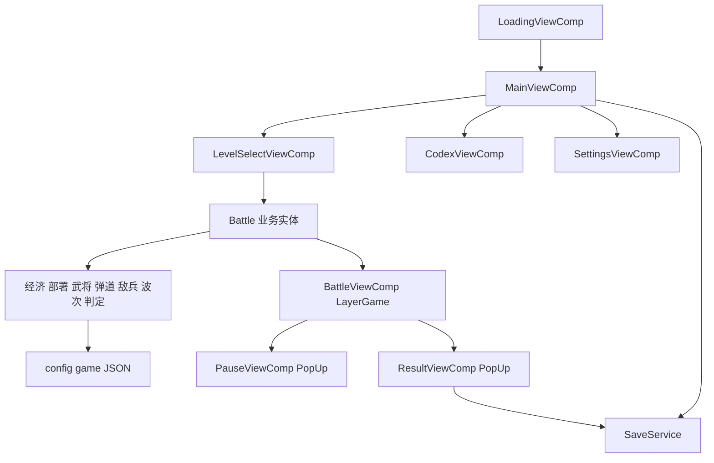

## 产品概述
在现有 Cocos Creator + oops-framework 工程上新增一款横屏（1280×720）三国题材塔防游戏：以"军粮"为资源，指挥蜀汉武将与器械驻守 5 行 × 9 列战场，抵御曹魏与黄巾敌军自右向左推进。首版为白天场景 12 关垂直切片，包含主界面、关卡选择、战斗、结算、图鉴、设置与本地存档；全部美术先用占位图形，后续替换真实素材不改代码。

## 用户要求
- 分析当前工程结构与框架，按既有架构扩展：不改框架源码、保留 Demo 与初始化流程，仅把加载完成后的入口改到游戏主界面。
- 输出完整、可执行的开发计划，细化到每个功能点与验收标准。

## 核心功能
1. 战斗核心：5×9 网格；粮草自动掉落、点击拾取、武将产出；卡片选择、冷却、消耗、放置校验、撤退令；武将类型含产粮、直射、减速、范围、爆炸、阻挡、光环；敌军含普通、快攻、护甲、跳跃、掘地、增益、Boss，具备行走、啃咬、受击、死亡状态；弹道与溅射；拒马保命；波次推进与胜负判定。
2. 关卡与进度：12 关配置化（初始粮草、可招募卡片、波次表、星级条件），关卡解锁链与星级存档。
3. 元系统：主界面、关卡选择、图鉴、设置（音乐、音效、自动拾取、语言、清档）、暂停（继续、重开、返回）、结算（星级、解锁、重试、下一关）。
4. 表现与体验：占位图形与兵种标注、可替换图路径、卡片冷却遮罩、粮草飞入、波次预警横幅、伤害飘字、结算星级动画、首关新手引导。
5. 稳定性：无美术与音频资源时正常降级；存档容错与版本迁移；战斗结束释放节点与资源。

视觉：玄墨底色配赤金描边的沙盘指挥台，5 行草地自左向右延伸，左侧城墙与拒马，右侧敌兵涌入口；顶部为粮草数字、卡片栏与波次进度，整体克制、厚重、易读。


## 一、项目现状与结论

- 引擎：Cocos Creator 3.8.8，TypeScript（strict），target ES2020，别名 `db://oops-framework/*`。
- 框架：oops-framework 3.6.3，`oops` 提供 log / config / storage / res / message / timer / audio / gui / game / language / ecs / mvvm / pool。
- 启动链：`assets/main.scene` → `Main extends Root` → `Initialize` → `InitialViewComp`（并行加载配置表 `JsonUtil.loadDir()`、语言包、`common` 资源）→ `LoadingViewComp`（加载 `game` 目录）→ `oops.gui.open(UIID.DemoMain)`。
- 配置表：`JsonUtil` 固定读取 bundle 内 `config/game/` 目录，当前 `assets/bundle/config` 为空。
- 资源：`assets/bundle` 为默认 bundle（`config.json` 中 `bundle.default = bundle`），`bundle/game` 完全为空，`bundle/audios` 仅剩 meta，无任何游戏美术。
- 关键约束（已验证源码）：`oops.gui.open` 只在 `LayerManager.uiLayers` 中查找，该集合只包含 LayerUI，因此 **LayerGame 无法通过 `oops.gui.open` 打开**，必须使用 `oops.gui.game.add(prefab, config)` 与 `oops.gui.game.remove(node)`；`@gui.register` 仅适用于 LayerUI / PopUp / Dialog。
- 结论：采用"配置表 + 纯逻辑战斗系统 + CCView 表现层 + 代码化 UI 组件"的分层方案，完全复用框架的启动、GUI、资源、存档、音频与多语言能力。

## 二、技术栈
- 引擎与语言：Cocos Creator 3.8.8、TypeScript（strict）。
- 框架：oops-framework（CCEntity / CCView / GameComponent / gui / res / storage / audio / language）。
- 渲染：2D UI 节点（Sprite、Label、Graphics、Widget、Button、tween），不使用物理引擎，网格碰撞自研。
- 数据：JSON 配置表 + 强类型 Table 访问类。
- 存档：`oops.storage`（框架已做本地加密与容量管理）。

## 三、实现方案与关键决策

1. 分层与依赖方向
   - 配置层：JSON + Table 访问器，只读，不改运行态。
   - 逻辑层：纯 TS 系统类（不引用 cc 渲染类型），持有 Actor 数据，便于测试与复用。
   - 表现层：`BattleViewComp` 每帧读取逻辑层增量结果并同步节点，不反向写入逻辑。
   - 元系统：GameComponent + `@gui.register` 的独立界面，通过事件与存档交互。

2. 战斗驱动方式
   - `BattleViewComp.update(dt)` 调用 `Battle.tick(dt)`；内部使用固定步长累加器（1/60），并裁剪 dt 上限 0.05 防止切后台后跳帧。
   - 倍速直接缩放累加时间，逻辑与表现共用同一时间轴，动画用 tween 独立播放。
   - 决策理由：不采用"每个士兵一个 ECS 实体"的粒度，避免上百实体的组件池与查询开销；Actor 以数据记录 + 对象池形式存在，网格塔防的碰撞是行内一维比较，性能与可读性更优。模块本身仍以 CCEntity 接入框架，符合现有约定。

3. 占位美术与可替换资源
   - `PlaceholderFactory` 在运行时用 ImageAsset + Texture2D 生成并缓存一张 2×2 白色 SpriteFrame，所有占位块复用该帧并设置 `Sprite.color`，避免每单位一张贴图与额外 DrawCall。
   - 配置项 `icon` 指向 `game/...` 下真实图；`ActorView` 先尝试 `oops.res.load(path, SpriteFrame)`，失败自动回退占位块，实现"换图零改代码"。
   - 兵种标识用子 Label（如"弩""甲""粮"），血条用两层 Sprite 缩放实现，不使用 Graphics 逐帧重绘。

4. UI 构建策略
   - 每屏一个极简预制体（根节点 + 视图脚本），界面内容由 `UIFactory` 在 `onLoad` 中一次性构建，避免手写大型 prefab JSON 的导入风险，同时保留框架的 open / close / 缓存 / 参数能力。
   - 若预制体导入异常，降级方案为把视图节点直接挂到 `oops.gui.root` 的 LayerUI 子节点并手动执行显示逻辑；此降级只在开发期使用。

5. 数据驱动与扩展性
   - 武将行为由配置 `kind` 决定，逻辑层用策略映射表分发（producer / shooter / wall / bomber / rowclear / support），新增兵种只加配置与一个策略函数。
   - 关卡、波次、敌兵、弹道全部外置 JSON；新增场景只需复制关卡目录并追加 levels 条目，代码零改动。
   - 平衡数值集中在 JSON，代码仅保留布局常量（5 行 9 列、格子 96×84、原点等）。

6. 性能与稳定性
   - 弹道、敌兵节点、伤害飘字、粮草图标全部走对象池；战斗结束统一回收并释放 `gui/battle` 资源。
   - 系统循环内不产生临时数组与闭包；行内查询以数组下标遍历，复杂度 O(同排单位数 + 同排敌兵数)。
   - Label 文本仅在数值变化时更新；显示节点引用在 onLoad 缓存，杜绝每帧 `getChildByName`。
   - 存档只在胜负、星级变化、设置修改时写入，避免高频 IO。

## 四、功能点与实现映射

| 功能点 | 实现位置 | 验收标准 |
| --- | --- | --- |
| 配置表加载与校验 | TableUnits / TableEnemies / TableLevels / TableWaves / TableProjectiles / TableValidator | 缺字段自动补默认值并告警，坏表不崩游戏 |
| 占位美术 | PlaceholderFactory / ActorView | 无素材时可完整通关，画面可辨识兵种 |
| 网格与坐标 | GridMap | 点击吸附准确，格子占用无重叠 |
| 粮草经济 | EconomySystem | 初始值、自然掉落、武将产出、上限、自动拾取均生效 |
| 卡片与部署 | CardBarView / DeploySystem | 冷却与禁用态正确，粮草不足禁止放置 |
| 撤退令 | DeploySystem.removeUnit | 仅可移除已放置单位，冷却与提示正常 |
| 武将行为 | UnitSystem + 策略表 | 七类行为符合配置，光环实时生效与撤销 |
| 弹道与伤害 | ProjectileSystem | 直线命中最近目标，溅射与减速正确 |
| 敌兵 AI | EnemySystem | 行走、啃咬、护甲、跳跃、掘地、Boss 行为正确 |
| 波次与进度 | WaveSystem | 时间轴出兵、大波横幅、进度条与配置一致 |
| 拒马保命 | LawnmowerSystem | 越界触发清行并消耗，二次越界判负 |
| 胜负与星级 | BattleJudge | 三种星级条件独立判定并取最高 |
| 暂停与倍速 | Battle / PauseViewComp | 暂停冻结逻辑，恢复无跳帧，倍速正确 |
| 关卡选择与解锁 | LevelSelectViewComp / SaveService | 通关解锁下一关，星级与锁定态准确 |
| 图鉴 | CodexViewComp | 数据与配置一致，分页与滚动正常 |
| 设置 | SettingsViewComp | 音量、开关、自动拾取、语言、清档即时生效并持久化 |
| 新手引导 | GuideSystem + 首关配置 | 首次进入按步骤高亮，完成后不再出现 |
| 音频 | AudioService | 缺音频文件不报错，开关与音量持久化 |
| 调试面板 | BattleDebugPanel | 仅开发期可见，可加粮、跳波、秒杀、显网格 |

## 五、架构设计



- 启动改造：`LoadingViewComp.onLoginSuccessGame` 打开 `UIID.Main`；Demo 保留但不作为入口。
- 战斗挂载：`Battle.open(levelId)` 先 `oops.gui.game.add('gui/battle/battle')` 取节点组件并 `add` 到实体，关闭时 `oops.gui.game.remove` 并销毁实体。
- 弹层：暂停与结算通过 `oops.gui.open(UIID.Pause / UIID.Result)` 走 PopUp 层，天然盖在战斗之上。

## 六、目录结构

```
assets/
├── bundle/
│   ├── config/game/
│   │   ├── units.json            # [NEW] 武将/器械表：id、名称、类型、消耗、冷却、血量、攻击、射程、弹道、减速、光环、icon、占位色、解锁与描述
│   │   ├── enemies.json          # [NEW] 敌军表：血量、移速、啃咬伤害、护甲、特殊行为、体型、占位色、掉落
│   │   ├── projectiles.json      # [NEW] 弹道表：速度、伤害倍率、穿透、溅射半径、颜色、命中特效
│   │   ├── waves.json            # [NEW] 波次表：关卡、波序、触发时间、大波标记、分组（兵种、行、数量、间隔）
│   │   ├── levels.json           # [NEW] 关卡表：初始粮草、掉落节奏、上限、可招募卡片、波次引用、预置单位、星级条件、解锁下一关
│   │   └── gameplay.json         # [NEW] 全局玩法：行列数、格子尺寸、原点、拒马数量、基础节奏
│   ├── gui/
│   │   ├── main/main.prefab            # [NEW] 主界面极简预制体（根节点 + MainViewComp）
│   │   ├── main/level_select.prefab    # [NEW] 关卡选择预制体
│   │   ├── main/codex.prefab           # [NEW] 图鉴预制体
│   │   ├── main/settings.prefab        # [NEW] 设置预制体
│   │   ├── battle/battle.prefab        # [NEW] 战斗场景预制体（根节点 + BattleViewComp）
│   │   ├── battle/pause.prefab         # [NEW] 暂停弹层
│   │   └── battle/result.prefab        # [NEW] 结算弹层
│   └── language/json/
│       ├── zh.json               # [MODIFY] 追加标题、按钮、提示、关卡名、单位描述等文案键
│       └── en.json               # [MODIFY] 同步英文文案键
└── script/game/
    ├── common/
    │   ├── config/GameUIConfig.ts        # [MODIFY] 追加 UIID.Main / LevelSelect / Codex / Settings / Pause / Result 及层与遮罩配置，保留 Demo
    │   ├── config/GameStorageConfig.ts   # [MODIFY] 追加存档键与设置键
    │   ├── config/GameEvent.ts           # [NEW] 全局事件名（粮草变化、波次横幅、战斗结束、存档变更）
    │   ├── table/ITable.ts               # [NEW] 配置接口与 UnitKind、EnemyKind 枚举
    │   ├── table/TableUnits.ts           # [NEW] 武将表访问器，含按关卡取卡片列表
    │   ├── table/TableEnemies.ts         # [NEW] 敌军表访问器
    │   ├── table/TableLevels.ts          # [NEW] 关卡表访问器，含解锁链查询
    │   ├── table/TableWaves.ts           # [NEW] 波次表访问器，按关卡聚合
    │   ├── table/TableProjectiles.ts     # [NEW] 弹道表访问器
    │   ├── table/TableValidator.ts       # [NEW] 表间引用校验、默认值填充与启动告警
    │   ├── save/SaveData.ts              # [NEW] 存档结构定义（版本号、解锁、星级、设置、引导标记、统计）
    │   ├── save/SaveService.ts           # [NEW] 读写、版本迁移、容错、清档
    │   ├── model/PlayerModel.ts          # [NEW] 运行态进度（最大解锁关、星级、统计）与变更通知
    │   ├── model/SettingsModel.ts        # [NEW] 音乐/音效/自动拾取/语言设置
    │   ├── ui/UIFactory.ts               # [NEW] 代码化 UI 组件库：面板、按钮、文本、进度条、滑块、开关、滚动列表、遮罩
    │   ├── ui/PlaceholderFactory.ts      # [NEW] 运行时白色 SpriteFrame 缓存、色块与兵种标注生成
    │   └── ui/AudioService.ts            # [NEW] BGM/SFX 封装，缺文件安全降级，读写音量开关
    ├── main/
    │   ├── MainViewComp.ts               # [NEW] 主界面：标题、继续征战、关卡选择、图鉴、设置、版本号
    │   ├── LevelSelectViewComp.ts        # [NEW] 12 关卡片、锁定态、星级、右侧详情与开始按钮
    │   ├── CodexViewComp.ts              # [NEW] 武将/敌军双页签列表与详情
    │   └── SettingsViewComp.ts           # [NEW] 音量、开关、自动拾取、语言、清档
    ├── battle/
    │   ├── Battle.ts                     # [NEW] CCEntity：open/close、tick、pause/resume、setSpeed、end
    │   ├── logic/Actor.ts                # [NEW] UnitInst / EnemyInst / ProjectileInst 数据与对象池
    │   ├── logic/BattleModel.ts          # [NEW] 战斗状态容器（粮草、时间、单位、敌兵、弹道、波次、状态）
    │   ├── logic/GridMap.ts              # [NEW] 行列与坐标互转、占用表、前排查询、同行范围查询
    │   ├── logic/EconomySystem.ts        # [NEW] 初始粮草、自然掉落、武将产出、上限与拾取
    │   ├── logic/DeploySystem.ts         # [NEW] 可放置校验、放置、撤退令、冷却管理
    │   ├── logic/UnitSystem.ts           # [NEW] 七类武将策略、攻击计时、光环增益计算
    │   ├── logic/ProjectileSystem.ts     # [NEW] 弹道推进、命中、穿透、溅射、减速
    │   ├── logic/EnemySystem.ts          # [NEW] 行走、啃咬、护甲、跳跃、掘地、增益、Boss
    │   ├── logic/WaveSystem.ts           # [NEW] 时间轴出兵、分组调度、大波横幅、进度计算
    │   ├── logic/LawnmowerSystem.ts      # [NEW] 拒马触发与同行清扫
    │   ├── logic/BattleJudge.ts          # [NEW] 胜负判定、星级计算、奖励与解锁写入
    │   └── view/
    │       ├── BattleViewComp.ts         # [NEW] CCView：构建战场与 HUD、驱动 tick、同步节点、输入
    │       ├── BattleHudView.ts          # [NEW] 粮草数字、波次进度、暂停、倍速
    │       ├── CardBarView.ts            # [NEW] 卡片列表、消耗、冷却遮罩、禁用态、选中态
    │       ├── BattleInput.ts            # [NEW] 指针到格子、幽灵预览、放置确认、取消与铲除
    │       ├── ActorView.ts              # [NEW] 通用演员节点（色块、标注、血条、受击闪白）与池
    │       ├── GuideOverlay.ts           # [NEW] 新手引导高亮与步骤提示
    │       ├── PauseViewComp.ts          # [NEW] 继续、重开、设置、返回主界面
    │       ├── ResultViewComp.ts         # [NEW] 星级动画、用时、解锁提示、重试、下一关
    │       └── BattleDebugPanel.ts       # [NEW] 开发期调试按钮
    ├── initialize/view/LoadingViewComp.ts # [MODIFY] 加载完成后打开 UIID.Main，不再直接进入 Demo
    └── demo/DemoMain.ts                   # [保持] 现有示例，不参与主流程
```

## 七、关键结构

```ts
export type UnitKind = 'producer' | 'shooter' | 'wall' | 'bomber' | 'rowclear' | 'support';

export interface UnitConfig {
  id: string; name: string; kind: UnitKind;
  cost: number; cooldown: number; hp: number;
  atk?: number; interval?: number; range?: number;
  projectile?: string; slow?: number; aura?: number;
  icon?: string; color: string; desc: string;
}

export interface LevelConfig {
  id: number; name: string; scene: string;
  initialFood: number; dropInterval: number; dropValue: number; maxFood: number;
  units: string[]; waves: string[]; mowers: number;
  prePlants?: { unit: string; row: number; col: number }[];
  starTime: number; perfectNoMower: boolean; unlockNext?: number;
}
```

## 八、实施注意（防回归）

- 打开战斗必须走 `oops.gui.game.add`，不要用 `oops.gui.open` 传 LayerCustomType.Game，否则控制台报"界面层不存在"。
- 配置表在 `InitialViewComp` 已整体加载，Table 访问器必须容忍 `JsonUtil.get` 返回 null，并给出一次性告警而非抛异常。
- `bundle/audios` 中 mp3 已缺失，`playMusic` / `playEffect` 需包 try/catch 或先判资源是否存在，避免加载报错刷屏。
- 战斗关闭顺序：先置状态为结束 → 回收节点池 → `oops.gui.game.remove` → 移除实体组件，防止 update 访问已销毁节点。
- 卡片栏、HUD、战场行节点在 onLoad 构建一次；后续只改数值与可见性，禁止每帧重建。
- 存档写入做节流（同帧多次变更合并为一次），并对读到的旧版本数据做字段兜底。
- 不改 `extensions/` 下框架代码；新增能力全部落在 `assets/script`。


## 设计风格
三国水墨沙盘与现代卡片面板结合：深墨背景、赤金细线描边、朱砂点缀，营造战场指挥台质感。占位阶段以色块承载兵种、以简短字标注（弩、甲、粮、骑），比例与层级即按正式美术预留，替换素材后布局不位移。

## 页面规划
1. 主界面
- 顶部标识区：竖排书法风标题"三国烽火"，副标题与版本号。
- 中央主操作区：最大号"继续征战"按钮，显示当前关卡与星级进度。
- 次级入口区：关卡选择、图鉴、设置三枚等宽卡片按钮，图标为线描器械。
- 底部信息区：进度统计（已通关联数、累计击杀）与清档入口，背景为山峦旗帜剪影。
2. 关卡选择
- 顶部栏：返回按钮、章节标题"黄巾之乱"、总星数。
- 关卡网格：12 张卡片按 4 列排布，含关卡号、名称、三星槽，未解锁显示锁与大字。
- 详情面板：右侧展示敌军预览、可招募单位缩略与星级条件。
- 底部操作：开始战斗主按钮与推荐等级提示。
3. 战斗界面
- 顶部 HUD：左侧粮草图标与数字，中部波次进度条与波次文本，右侧暂停与倍速按钮。
- 卡片栏：横向卡片列表，含消耗、冷却径向遮罩、不可用灰态、选中金边。
- 战场区：5 行 9 列草地，行选中高亮，左侧城墙与拒马，右侧敌军入口警示箭头。
- 底部操作条：撤退令、取消当前选择、下一波预告与提示文本。
4. 战斗弹层（暂停与结算）
- 暂停：半透明遮罩居中木纹面板，标题、当前关卡波次、继续、重开、设置、返回四项纵排。
- 结算：三星逐颗点亮，展示关卡名与用时，胜利显示解锁提示与奖励，失败显示越过防线原因。
- 操作区：重试、下一关、返回主界面，主按钮赤金填充。
5. 图鉴
- 顶部：返回、页签"武将器械 / 敌军"、筛选标签。
- 列表：左侧滚动条目，色块头像加名称，攻防类型标签。
- 详情：右侧大字名称、属性行（血量、攻击、射程、冷却）、技能与克制描述。
- 底部：提示条说明图鉴随关卡推进自动解锁。
6. 设置
- 顶部：返回与标题。
- 音频区：音乐、音效两条滑块加开关，实时试听。
- 玩法区：自动拾取粮草、战斗倍速默认值开关。
- 其他区：语言切换、清档按钮（二次确认）、版本与框架信息。

## 交互与动效
- 按钮悬浮上浮 2px 并加金色描边，按下回弹；卡片选中时外发光。
- 冷却遮罩自上而下扫描，结束时轻闪一次提示可用。
- 粮草产出沿贝塞尔曲线飞入计数器，数字跳动放大后回落。
- 大波来袭时横幅自右侧滑入、暂停 0.8 秒后淡出，伴随屏幕轻微震动。
- 伤害飘字上浮渐隐，受击演员闪白，死亡缩放消散。
- 面板弹出为 0.92 缩放到 1 的缓动加淡入，关闭反向播放。

## 适配
设计分辨率 1280×720，按高度适配并居中，横向留边使用墨色底；战场按可用高度等比缩放，格子坐标由布局计算得出；移动端启用安全区，弹层与按钮避开刘海与圆角。

## Agent Extensions
### SubAgent
- **code-explorer**
  - Purpose: 在实现战斗模块前，精确复核 oops 框架的 LayerGame 挂载、GUI 生命周期、CCView 与 CCEntity 绑定、资源加载与存储 API 的真实签名与调用顺序。
  - Expected outcome: 输出与源码一致的调用方式清单，避免打开战斗层失败、组件与实体绑定错位等实现期返工。
