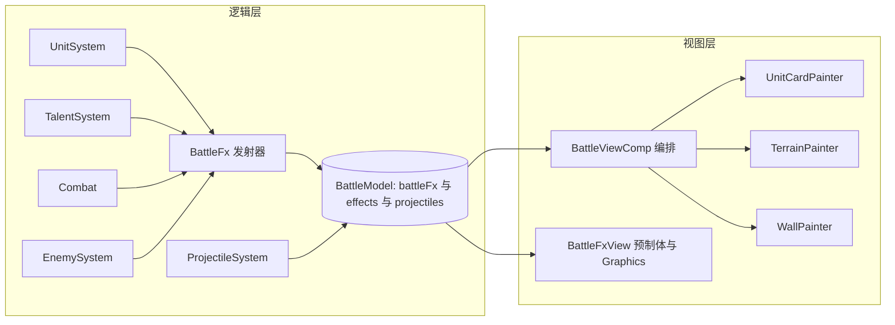

## 用户需求
以历史单文件项目（三国武将志.html + game-config.js）为基准，全面核对当前 Cocos 工程战斗功能迁移完整度（排除图鉴与关卡选择界面），重点补齐武将天赋特效、弹道特效与图形表现，并输出可执行的改进计划。

## 产品概述
当前工程已迁移核心战斗、敌兵种机制、计略、装备、羁缘、无尽与引导，但表现层与历史有明显差距。本次目标是把战斗「看得见、打得爽」的表现层对齐历史项目：每位武将有专属起手动作、技能名播报、主题色特效与屏震；玩家与敌方都有真实弹道美术；武将/敌方由「色块+单字」升级为阵营渐变剪影并可逐张替换真实肖像；地形与城墙具备手绘级表现。

## 核心功能
- 天赋表现：23 位武将全部具备专属起手（近战挥兵/弓手拉弓/法师聚能）、专属特效、技能名播报与分级屏震；落地 talent.dtype 与 talent.yield。
- 弹道表现：箭矢/飞刃/回旋镖/抛石各有美术；贯穿与抛物线表现正确；敌方抛射/弩兵/骑射生成可见弹道与枪口特效。
- 特效补全：接线全部 15 种程序化特效（sweep/wave/cast/bowdraw/graincart/bagua/shout/slash/trail 等），粮车与八卦阵可视化，曹操/甄姬全体增益有明确反馈。
- 武将图形：程序化剪影（阵营渐变+高光+单字+血条+状态）兜底，并支持 per-hero 肖像图覆盖；整卡霜冻/中毒/眩晕/护甲等状态表现。
- 场景美术：雪顶高山、河流、砖纹城墙与破损/火光分档绘制。

## 视觉与体感
战斗中清晰可读：每招有主题色与技能名、命中有冲击、暴击/斩杀/大技有分级屏震；弹道朝向准确、命中反馈明确；武将不再是单调色块，而是有辨识度的剪影卡片。


## 技术栈
- 引擎：Cocos Creator 3.x + oops-framework（既有）
- 语言：TypeScript（严格类型，现有分层：logic 产事件 / view 消费）
- 渲染：预制体 + tween（既有粒子/爆发）+ 新增 `cc.Graphics` 程序化矢量绘制层（剪影、地形、城墙、箭头/回旋镖、八卦阵、音波/刀光等）
- 数据：`assets/bundle/config/game/*.json` 数据驱动，`common/table` 解析

## 实现思路
保持「逻辑只产数据、视图只消费」的分层不变。逻辑层通过 `BattleFx` 发浇统一特效事件、通过 `model.addEffect` 发浇表现事件、通过 `ProjectileSystem` 生成弹道；视图层由一个统一的 `BattleFxView` 消费全部 `battleFx`：
- 粒子/爆发类（impact/muzzle/shard/burst/castaura/shockwave/line/fire/die）继续用 `actor_bullet`、`fx_burst` 预制体 + tween；
- 矢量几何类（sweep/wave/cast/bowdraw/graincart/bagua/shout/slash/trail）与弹道美术改用一张 `Graphics` 绘制层逐帧绘制（形状少、开销可控）。
武将/敌方卡片由新增 `UnitCardPainter`（`Graphics`）按「阵营渐变+斜向高光+单字+血条+状态」绘制，有 `portrait` 字段时用图片覆盖；地形/城墙由 `TerrainPainter`/`WallPainter` 绘制。

关键决策与权衡：
- 统一 `BattleFxView` 作为唯一特效消费者，避免多条管线重复消费与事件被吞（当前 `shout` 被吞正是缺分支）。
- 矢量特效走单张 `Graphics` 而非「每个特效一个节点」，减少节点与 GC 压力，贴近历史 canvas 绘制方式，易做到表现级一致。
- 剪影用 `Graphics` 程序化绘制（零素材、立即见效），`portrait` 字段预留图片覆盖（两者结合）。
- 逻辑层不做任何绘制；新增表现指令一律走数据字段与事件，保证可测试、可替换。

性能与可靠性：
- `Graphics` 每帧重绘的图元控制在几十个量级（一个武将一卡 + 若干特效 + 少量弹道），O(单位数+特效数)；粒子用对象池并设上限（沿用 `floatCount` 思路）。
- 禁止使用 `scaleX/scaleY/x/y` 独立属性补间，统一 `scale: Vec3` / `position: Vec3` / `opacity`，规避 tween null-keys 崩溃。
- 音频与屏震节流复用 `playThrottled` 思路；特效事件按 life 自然清理，防止泄漏。

## 架构设计


数据流：`UnitSystem/TalentSystem/Combat/EnemySystem` 触发 `BattleFx`/`addEffect`/`spawn*` → `BattleModel` 暂存 → `BattleViewComp` 每帧 `sync* + drainEffects + battleFxView.sync` → 各 Painter 绘制。

## 实现要点
- `dtype` 落地：`blade` 走近战挥兵 `sweep`，`magic` 走聚能 `castaura/cast`，`buff/passive` 走柔光；弓手/弩手按 `cfg.projectile` 走 `bowdraw`。
- `yield` 落地：`updateProducer` 优先读 `talent.yield`，与 `cfg.produce` 数值统一，避免两处不一致。
- 敌方弹道：`EnemySystem.fireAtFrontUnit` 生成玩家侧可见弹道（抛石走 Arc、弩/骑射走 Line，反向朝左）+ `muzzle` 特效。
- 屏震：新增 `screenShake(amp)` 对战场根节点做短促 tween；暴击/斩杀/大技分级；`drainEffects` 增加 `shout`、`skill` 分支，杜绝事件被 `effects.length=0` 吞掉。
- 技能名播报：新增 `skill` 表现事件（携带 name/kind/color），视图在施法者上方弹出并随时间淡出。
- 保持向后兼容：新增字段全部 `?` 可选；缺 `visual`/`portrait` 时回退到现有色块与圆点；不触碰图鉴与关卡选择。

## 目录结构
```
assets/script/game/common/table/
  ITable.ts                     [MODIFY] 扩展 ProjectileKind/visual/spin/tail；IUnitConfig/IEnemyConfig 增 portrait；IBattleFx 增 bowdraw/graincart/bagua/shout 字段；BattleEffectKind 增 skill/shake
assets/bundle/config/game/
  projectiles.json              [MODIFY] 新增 knife/boomerang/fireArrow 等，补 visual/spin/tail/splash
  units.json                    [MODIFY] 校齐 talent.dtype 与 talent.yield，预留 portrait 字段
assets/script/game/battle/logic/
  BattleFx.ts                   [MODIFY] 新增 cast/bowdraw/wave/shout/graincart/bagua/slash/trail/shake 发射器
  UnitSystem.ts                 [MODIFY] updateShooter 按 dtype/projectile 发浇起手与多排枪口；updateProducer 读 talent.yield 并发浇 graincart
  TalentSystem.ts               [MODIFY] cast 前发浇 beginCast/announce；按 dtype 分派；补 juma/thorns 表现
  EnemySystem.ts                [MODIFY] fireAtFrontUnit 生成可见敌方弹道与 muzzle；被拒马阻挡时发浇 impact
  ProjectileSystem.ts           [MODIFY] 支持 spin/boomerang/pierce 视觉与抛射抬升；命中发浇 crit/impact
  Combat.ts                     [MODIFY] 暴击/击杀/受击发浇分级屏幕震动与命中特效
  Actor.ts                      [MODIFY] BattleFxKind 扩展；IBattleEffect 增 text/who 与 skill/shake
assets/script/game/battle/view/
  BattleFxView.ts               [MODIFY] 新增单张 Graphics 绘制层：15 种特效与弹道矢量美术，粒子仍用预制体
  BattleViewComp.ts             [MODIFY] 新增 screenShake/announceSkill；drainEffects 处理 shout/skill；编排各 Painter
  UnitCardPainter.ts            [NEW] 武将/敌方卡片绘制：渐变/高光/单字/血条/状态/肖像覆盖
  TerrainPainter.ts             [NEW] 地形行绘制：雪顶高山、河流
  WallPainter.ts                [NEW] 城墙绘制：砖纹、裂纹、火光分档
assets/bundle/gui/battle/
  battle.prefab                 [MODIFY] 预留 paint_unit/paint_fx/terrain/wall 绘制节点（缺省时运行时补齐）
```

## 关键代码结构
```ts
export type ProjectileVisual = 'arrow' | 'knife' | 'boomerang' | 'stone' | 'orb';

export interface IProjectileConfig {
    id: string;
    kind: ProjectileKind;        // 保留 Line | Arc
    speed: number;
    color: string;
    width?: number;
    splash?: number;
    slow?: number;
    slowDuration?: number;
    visual?: ProjectileVisual;   // 新增：弹道美术样式
    spin?: number;               // 新增：回旋镖自转角速度（弧度/秒）
    tail?: boolean;              // 新增：是否拖尾
}

export interface UnitCardOptions {
    id: string;
    tag: string;
    color: string;
    portrait?: string;           // 可选：per-hero 肖像图路径，缺省用程序化剪影
    width: number;
    height: number;
    hpRatio: number;
    armorRatio?: number;
    status?: { slow?: boolean; poison?: boolean; stun?: boolean; dual?: boolean };
}
```


## Agent Extensions
### SubAgent
- **code-explorer**
  - Purpose: 在实施前精确定位受影响符号与调用点（BattleFxKind 全引用、ProjectileSystem 调用点、syncUnits/syncEnemies/drainEffects 结构、ITable 解析链路）
  - Expected outcome: 输出按文件的功能点清单与需改动的精确行区间，避免遗漏与重复消费
### Skill
- **lsp-code-analysis**
  - Purpose: 用 LSP 语义能力核对 BattleFxKind/IProjectileConfig/IBattleEffect 的定义、引用与实现，评估字段扩展影响面
  - Expected outcome: 得到准确的引用清单与类型影响分析，保证新增字段不破坏现有调用
